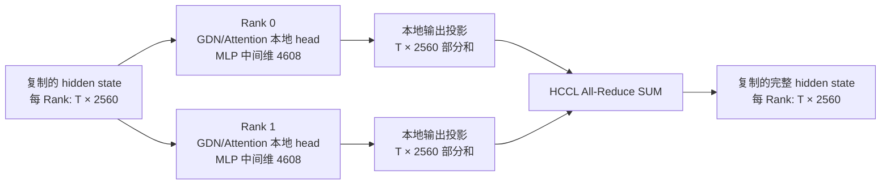

# 作业 2：Qwen3.5 双 Chip 张量并行与通信分析

## 摘要

在一张 Ascend 910C 的两个 Chip 上，我们使用 TokenSpeed 的张量并行和 HCCL
后端分别运行 Qwen3.5-0.8B、4B、9B、27B。四个模型各完成 15 条连续 TP=2
请求；其中 0.8B、4B、9B 另与单 Chip TP=1 对照，27B 用独立 Hugging Face
实现作参考。双 Rank 的同层权重分片、服务日志及设备占用共同证明运行的是
**一个模型跨两 Chip 的 TP=2**。以 4B 为例，GDN、Full Attention 和 MLP
分别在本地 Head/通道上计算，并在输出投影后归约局部部分和。0.8B 的两档
输入长度 × 两档并发测试显示，TP=2 的吞吐收益取决于负载：短输入单请求为
TP=1 的 0.89 倍，短输入并发 4 为 1.63 倍。9B TP=2 补充了性能和双 Chip
HBM 数据。并发实验进一步显示，系统吞吐增加伴随首 Token 等待增加。

## 1. 实验环境与测量方法

| 项目 | 四模型连续推理与正确性对照 | 本报告的性能与通信实验 |
|---|---|---|
| 代码 | TokenSpeed `feat/qwen35-9b-27b-tp2` 分支 | 同分支源码快照 `22db9ec8` |
| 硬件 | Ascend 910C；物理 NPU 6/7，各 65536 MB HBM | 同左，TP=1 仅使用 NPU 6 |
| 软件 | CANN 9.0.0；PyTorch / torch-npu 2.9.0 | CANN 9.0.0；PyTorch / torch-npu 2.6.0 |
| 模型与精度 | Qwen3.5-0.8B/4B/9B/27B，BF16 | 同一 0.8B 权重做 TP 对照；9B 使用官方 BF16 权重 |
| 推理设置 | `mha`、greedy、关闭 Thinking；各次启动参数见原始日志 | `mha`、greedy、关闭 Thinking/前缀缓存，`max_model_len=4096` |

两组实验的软件版本不同，**正确性数据和性能数据不作为同环境数值对照**。
模型分别启动和测试，并未同时驻留。正确性测试包含 12 条不同 Prompt
和 A1 → B → A2 三条交错状态隔离请求；TP=1/2 使用相同权重、BF16、
输入 Token IDs、输出长度与 greedy 配置。完整输出一致性按服务端记录的
**Token ID 序列**比较，不以 API 文本重新编码代替。

性能测试将 chat template 后的实际输入长度控制为 32 或 1024 Token，
每请求最多生成 32 Token，`ignore_eos=true`。每格预热一波、正式测三波；
系统吞吐为三波成功生成的 Token 总数除以三波总墙钟时间。TTFT 是客户端
发出请求至首个非空流式内容块的时间；TPOT 用首末内容块时间差除以服务端
报告的生成 Token 数减一，属于估计值。P50/P95 是最邻近的实测样本分位数。
HBM 每 0.5 秒通过 `npu-smi` 采样，数字是**物理 Chip 的设备总占用**，
包含其他用户进程，不是模型独占显存或严格瞬时峰值。完整复现命令见
[`README-hw2.md`](../local_tests/qwen35/README-hw2.md)。

## 2. 双 Chip 启动、连续推理与正确性

双 Chip 适配沿用 TokenSpeed 的 Scheduler 多进程启动和 HCCL 通信路径：
启动参数把同一模型的 TP Size、World Size 和本机进程数都设为 2，
而非在两个 Chip 上各启动一个完整模型副本。0.8B/4B 的团队采集脚本
[`collect_qwen35_evidence.sh`](../test/ci_system/collect_qwen35_evidence.sh)
会检查模型目录和端口、保存启动环境与 NPU 快照，并调用 TP=2 服务脚本。
并行 Linear 层按输出或输入维加载局部权重，Attention/GDN/MLP 随局部
Head/通道执行，输出部分和在通信边界合并；第 3 节展开这一对应关系。

TP=2 启动时设置 `ASCEND_RT_VISIBLE_DEVICES=6,7`、`world_size=2`、
`attn_tp_size=2`、`nprocs_per_node=2`。Rank 0/1 分别选进程内可见 NPU 0/1；
按可见设备顺序推导，它们对应物理 NPU 6/7。`npu-smi` 确认两颗目标 Chip
均有 Scheduler 进程，日志确认两个 Rank 载入同一模型的不同局部权重。
当前摘录没有直接打印 `rank → 物理 NPU` 的绑定行，因此该映射是依据启动
配置和进程表推导。以下运行记录与设备快照来自
[`团队实验记录`](qwen35_tp2_experiment_record.md)、
[`9B 双 Rank 摘录`](evidence/9b_tp2_runtime.txt)及
[`27B 双 Rank 摘录`](evidence/27b_tp2_runtime.txt)。

| 模型 | 两 Rank 的同层 GDN `out_proj` 权重 | TP=2 连续请求 | 运行期物理 NPU 6/7 总 HBM 单次快照 |
|---|---|---:|---:|
| 0.8B | 团队 0.8B 启动记录；下文另有 TP=2 性能实测 | 15/15 | 见第 4 节逐配置采样 |
| 4B | 典型层逻辑分片见第 3 节 | 15/15 | 原始记录由团队保存 |
| 9B | 完整 `[4096,4096]`，每 Rank `[4096,2048]` | 15/15 | 41932 / 41333 MB |
| 27B | 完整 `[5120,6144]`，每 Rank `[5120,3072]` | 15/15 | 48973 / 48377 MB |

9B/27B 的两个 Rank 均打印了同层 `checkpoint_shape`、`local_shape` 和
`input_dim=1`；再结合 15 条连续推理响应，证据超出了“仅启动两个进程”
或“加载两份完整模型”的层次。9B 另由本报告重新启动并取得
[`双 Rank 日志摘录`](evidence/9b_tp2_runtime_c.txt)和 30 条性能请求结果。
上述 HBM 是共享设备在**另一次团队运行**中的快照，不能与本报告性能测量
时的 HBM 峰值混用。

| 模型 | TP=1 连续请求 | 参考路径 | 完整输出 Token ID 一致性 |
|---|---:|---|---:|
| 0.8B | 15/15 | TokenSpeed TP=1 vs TP=2 | 11/15 |
| 4B | 15/15 | TokenSpeed TP=1 vs TP=2 | 8/15 |
| 9B | 15/15 | TokenSpeed TP=1 vs TP=2 | 10/15 |
| 27B | 当前单 Chip 条件下未完成 | HF BF16 vs TokenSpeed TP=2 | 8/15 |

27B 的单 Chip 尝试因当前缓存/快照池及单请求可用 Token 容量不足而未完成。
其 HF 参考把 BF16 权重**按层放在两颗 NPU**，不属于 TP=1，因而不存在可
填写的 27B 单 Chip 加速比。HF 参考的语言模型权重 851/851 项按预期加载，
无 Missing、Unexpected 或 Mismatched 项；仍须考虑框架算子的数值差异。

4B 另比较 HF、TokenSpeed TP=1 和 TP=2，三方实际输入 Token IDs 在
15/15 条请求中相同；完整输出序列的一致数分别为 HF–TP1 6/15、HF–TP2
8/15、TP1–TP2 8/15，**三方首 Token 15/15 一致**。例如 `case_03`、
`case_10` 的 TP1/TP2 整条序列相同而 HF 不同，说明不能把 HF 与 TP2 的
分歧全部归咎于张量并行。逐 Case 汇总见
[`4b_three_way_summary.json`](evidence/4b_three_way_summary.json)。
0.8B `case_09` 的相同 142 个输入 Token 在 TP1/TP2 下首 Token 不同，首步
Logits 的 MAE 约 0.03114、最大绝对误差约 0.203125；差异与分片计算顺序
及有限精度舍入相容，但根因未被单独证实。27B `case_06` 的 HF 首步前两候选
Logit 只差 0.125，TP2 同步完整 Logits 尚缺，不能断言哪条路径更准确。
**完整序列一致率是数值路径对照，不能当成模型语义正确率。**

## 3. 典型层切分与通信路径

选 Qwen3.5-4B：Hidden Size 为 2560，32 层含 24 层 GDN 和 8 层
Full Attention，MLP Intermediate Size 为 9216。下图中 `T` 是当前 Forward
的 Token 行数，`S` 是已缓存序列长度；权重按 `[out, in]` 表示。形状依据
模型配置与并行层源码推导，属于**逻辑形状**，并非每个中间张量的运行时 Dump。
详细推导见[`4B 切分说明`](qwen35_4b_tp2_partition_communication.md)。

| 结构与阶段 | 完整逻辑形状 | Rank 0 与 Rank 1 各自的局部形状 | 数据分布 / 通信 |
|---|---|---|---|
| 层输入 X | `[T,2560]` | 各 `[T,2560]` | 逻辑复制；两个 Rank 处理同一批 Token |
| GDN Q/K/V/Gate | Q/K 各 `[T,2048]`；V/Gate 各 `[T,4096]` | Q/K 各 `[T,1024]`；V/Gate 各 `[T,2048]` | 输入投影按 Head/通道切分；此处无集合通信 |
| GDN B/A 与合并投影 | B/A 各 `[T,32]`；投影逻辑权重 `[12352,2560]` | B/A 各 `[T,16]`；投影逻辑权重各 `[6176,2560]` | 按输出通道切分；实际实现可能拆分投影 |
| GDN Conv 权重 | `[8192,1,4]` | 各 `[4096,1,4]` | 每 Rank 只处理本地 Q/K/V 通道 |
| GDN `out_proj` 权重与输出 | `[2560,4096]`；完整输出 `[T,2560]` | 各 `[2560,2048]`；各得 `[T,2560]` 部分和 | Row Parallel；经 `post_attn_comm()` All-Reduce SUM 后输出复制 |
| Full Attention Q/K/V | Q `[T,16,256]`；K/V 各 `[T,4,256]` | Q 各 `[T,8,256]`；K/V 各 `[T,2,256]` | 按 Head 切分，本地执行 Attention |
| Full Attention `o_proj` | `[2560,4096]` | 各 `[2560,2048]`；输出各 `[T,2560]` 部分和 | 经 `post_attn_comm()` All-Reduce SUM |
| MLP Gate/Up 权重与输出 | 权重各 `[9216,2560]`；输出各 `[T,9216]` | 权重各 `[4608,2560]`；输出各 `[T,4608]` | Column Parallel，本地激活 |
| MLP Down 权重与输出 | `[2560,9216]`；完整输出 `[T,2560]` | 各 `[2560,4608]`；各得 `[T,2560]` 部分和 | 经 `post_mlp_comm()` → `post_dense_comm()` All-Reduce SUM |

对 Row Parallel 输出投影，两个 Rank 的结果分别为
`Y₀ = X₀W₀ᵀ`、`Y₁ = X₁W₁ᵀ`，All-Reduce 使双方得到完整的
`Y = Y₀ + Y₁`。`out_proj`/`o_proj` 设置 `reduce_results=False`，
本地 Linear 不直接归约，由后续 `CommManager` 在逻辑边界执行。标准非
Token-Sharded 路径满足相应分支条件时使用 All-Reduce；框架的其他配置
可能走 Reduce-Scatter 或 All-to-All，不能把它们写成本次层内主路径。

| 推理状态 | 单请求完整逻辑形状 | 每 Rank 逻辑形状 | Prefill/Decode 处理 |
|---|---|---|---|
| GDN Conv State | `[8192,3]` | `[4096,3]` | 本地通道的历史窗口滚动更新 |
| GDN Recurrent State | `[32,128,128]` | `[16,128,128]` | 本地 Value Head 的递归状态更新 |
| Full Attention K/V Cache | K、V 各 `[S,4,256]` | K、V 各 `[S,2,256]` | 写入本地 KV Head，序列逻辑长度增加 |

这些状态按请求隔离、按 Head/通道分片，标准 Prefill/Decode 不逐步跨 Rank
交换完整 State。表中是逻辑视图，物理 Cache Pool/Paged KV Cache 布局可能
不同。每次 `[T,2560]` BF16 归约的**每 Rank 输入张量**为
`T×2560×2 = 5120T` 字节：单 Token Decode 约 5 KiB，`T=128` 的
Prefill 约 640 KiB。这不是实际 HCCL 链路流量或整个模型的通信总量。
Embedding、输出及框架级操作也可能通信。

## 4. 0.8B TP=1/2 性能对照

服务采用相同权重、BF16、`mha`、greedy、关闭 Thinking 和前缀缓存，
`max_model_len=4096`、`max_num_seqs=8`、`gpu_memory_utilization=0.30`。
输入经 chat template 后的实际长度精确为 32/1024 Token，每格预热 1 波、
测量 3 波；TP=1/2 各 30 个正式请求全部成功。表内数值分别来自
[`TP1 原始记录`](evidence/08b_tp1_benchmark_c.json)和
[`TP2 原始记录`](evidence/08b_tp2_benchmark_c.json)。

| 输入 Token | 并发 | TP1 吞吐 tok/s | TP2 吞吐 tok/s | TP2/TP1 | TP1 TTFT P50 s | TP2 TTFT P50 s | TP1 TPOT P50 ms | TP2 TPOT P50 ms |
|---:|---:|---:|---:|---:|---:|---:|---:|---:|
| 32 | 1 | 23.12 | 20.63 | 0.89× | 0.138 | 0.134 | 41.97 | 45.40 |
| 32 | 4 | 45.98 | 75.09 | 1.63× | 0.320 | 0.225 | 39.33 | 47.59 |
| 1024 | 1 | 13.67 | 15.22 | 1.11× | 1.178 | 0.662 | 36.72 | 45.09 |
| 1024 | 4 | 18.44 | 25.17 | 1.37× | 4.498 | 2.308 | 38.82 | 48.50 |

TP=2 在短输入单请求时没有吞吐收益；长输入 Prefill 的 TTFT 收益更明显。
并发 4 提高系统吞吐，但长输入下 TP=2 的 TTFT P95 仍达到 6.14 s，
说明排队或批处理尾部开销不能由吞吐数字掩盖。TP=2 的 TPOT 高于 TP=1，
与 Decode 小批量通信及额外同步开销相容；仅凭此表不能把差值完全归因于 HCCL。

| 配置 | 物理 NPU 6 总 HBM 峰值 MB | 物理 NPU 7 总 HBM 峰值 MB |
|---|---:|---:|
| TP1，32 输入，并发 1/4 | 26473 / 26478 | — |
| TP1，1024 输入，并发 1/4 | 26569 / 27098 | — |
| TP2，32 输入，并发 1/4 | 26132 / 26135 | 25532 / 25534 |
| TP2，1024 输入，并发 1/4 | 26185 / 26370 | 25585 / 25769 |

以上是共享设备的 `npu-smi` **总占用**，包括其他进程，且 0.5 秒采样可能漏掉
瞬时峰值；不能直接解释为模型独占 HBM，也不能把两颗设备的总量与单卡模型
显存作精确节省率比较。成员 B 的 9B/27B TP=2 单次运行快照分别为
`41932/41333 MB` 与 `48973/48377 MB`（物理 NPU 6/7），也同属设备总量，
不是独占峰值。

## 5. 较大模型 Qwen3.5-9B 的 TP=2 性能与容量

从[官方 Qwen3.5-9B 模型仓库](https://modelscope.cn/models/Qwen/Qwen3.5-9B/summary)
下载 BF16 权重，模型索引列出的四个 safetensors 分片均完整到位。
`config.json` 的 SHA256 为 `d0883072e01861ed0b2d47be3c16c36a8e81c224c7ffaa310c6558fb3f932b05`，
权重索引的 SHA256 为 `26d3539b516be613f39563617cb9d33b3f83d401298125be392c80cefb8f7fe5`。
成员 B 的日志没有给出权重修订哈希，因此这里只确认相同公开模型名和 BF16，
不声称字节级相同权重修订。服务参数为 TP=2、`mha`、greedy、
`max_model_len=4096`、`max_num_seqs=8`、`gpu_memory_utilization=0.55`，
关闭 Thinking 和前缀缓存，物理 NPU 6/7。两个 Rank 对同一层的
`out_proj.weight` 均从 `[4096,4096]` 加载为不同的 `[4096,2048]` 分片；
关键启动行见[双 Rank 日志摘录](evidence/9b_tp2_runtime_c.txt)。

沿用第 4 节的测量口径：实际输入长度 32/1024 Token，每格预热 1 波、
正式测量 3 波，每请求生成 32 Token，30 个正式请求全部成功。逐请求结果、
每波墙钟时间和 0.5 秒间隔 HBM 样本见
[`9b_tp2_benchmark_c.json`](evidence/9b_tp2_benchmark_c.json)。

| 输入 Token | 并发 | TP2 吞吐 tok/s | TTFT P50 / P95 s | TPOT P50 ms | 物理 NPU 6/7 总 HBM 峰值 MB |
|---:|---:|---:|---:|---:|---:|
| 32 | 1 | 16.06 | 0.189 / 0.217 | 57.59 | 42697 / 42097 |
| 32 | 4 | 35.48 | 0.428 / 4.274 | 61.46 | 42697 / 42097 |
| 1024 | 1 | 9.81 | 1.454 / 1.459 | 57.69 | 42869 / 42269 |
| 1024 | 4 | 14.78 | 5.448 / 9.358 | 62.34 | 44364 / 43108 |

服务加载后、正式测量前的设备总 HBM 为 `42690/42091 MB`；长输入并发 4
的采样峰值为 `44364/43108 MB`。这些均为共享设备总量，不能将峰值与前值
之差完全解释为模型 KV cache，也不代表模型独占容量。9B 的并发 4 吞吐高于
并发 1，但长输入 TTFT P95 达到 9.358 s，说明容量允许并发不等于延迟无代价。
本次 9B 与第 4 节 0.8B 的权重、输入 Token 内容及共享负载不同，不能仅从
两表直接计算模型大小带来的性能比例。

## 6. 通信相关实验与时间线

**假设与变量：**固定 0.8B 权重、TP=2、1024 输入 Token、32 输出 Token、
服务参数和物理 NPU 6/7，只改变同时发出的请求数为 1、4、8。每格预热一波，
正式测量三波；所有 39 个正式请求成功。按批处理机制，请求并发增加会使每次
集合通信所处理的 Token 数增多，但 All-Reduce 仍需跨 Chip 同步；预期系统
吞吐提高，单请求等待也可能增加。原始记录见
[`08b_tp2_concurrency_c.json`](evidence/08b_tp2_concurrency_c.json)。

| 并发 | 吞吐 tok/s | TTFT P50 s | TTFT P95 s | TPOT P50 ms | 物理 NPU 6/7 总 HBM 峰值 MB |
|---:|---:|---:|---:|---:|---:|
| 1 | 14.99 | 0.657 | 0.663 | 46.65 | 26180 / 25584 |
| 4 | 33.78 | 2.311 | 2.318 | 47.45 | 26346 / 25748 |
| 8 | 42.66 | 4.524 | 4.526 | 47.83 | 26728 / 26131 |

**结论：**并发 8 相比并发 1 的系统吞吐为 2.85 倍，TTFT P50 也增至
6.88 倍；TPOT 仅从 46.65 增至 47.83 ms。较大的 batch 能摊薄固定调度
与通信启动开销，并提高计算利用率，但会增加等待和单请求首 Token 延迟。
这些同时变化的因素不能仅凭吞吐曲线分离出 HCCL 的独立收益，也不能声称
“通信占比下降”已经实测。两颗 NPU 的 HBM 仍是共享设备总量。

**Profiler 时间线：**另用 CANN 9.0.0 的 `msprof` 开启 HCCL、任务时间与
Runtime API 采集 TP=2；详见
[`Rank 1 HCCL 统计原表`](evidence/08b_tp2_msprof_rank1_communication_c.csv) 与
[`时间窗摘要`](evidence/08b_tp2_msprof_summary_c.json)。Rank 1 / 物理 NPU 7
导出 4526 个 `hcom_allReduce_`、92 个 Broadcast、92 个 AllGather；前者在
**该 Rank 的 HCCL 累计 task duration** 中占 96.077%。这与典型层局部输出
经 All-Reduce 合并的源码路径相符；Broadcast/AllGather 也说明全服务通信
不止层内归约。统计涵盖整个 profiler 窗口，含启动和预热，不能对应单个请求。

在 Rank 1 的一个 10 秒时间窗，按 `op_summary` 的任务类型区分如下：

| 任务类别 | 任务数 | 任务时间区间并集 s | 逐任务 `Task Wait Time` 累计 s |
|---|---:|---:|---:|
| AI Core / Vector / Mix 计算 | 10919 | 0.116 | 1.312 |
| `hcom_` 集合通信 | 796 | 9.724 | 0.023 |
| AI CPU 等其他任务 | 907 | 0.169 | 0.153 |

`Task Wait Time` 三类累计约 1.487 s，属于逐任务排队字段，**不是**主机
调度等待或端到端等待；该采集无法可靠拆出服务端排队时间。计算与通信区间
可能重叠，各类别时间不得简单相加。Profiler 显著拖慢请求，
而 Rank 0 未导出设备数据，因此这些数字仅证明采集窗口内的通信类型及设备
时间分布，**不能作为无 profiler 性能基线或双 Rank 通信占比**。无 profiler
的 TTFT 与吞吐取自上表及第 4 节。

## 7. 结论、限制与证据索引

四个指定模型分别完成 TP=2 连续推理；9B/27B 的同层双 Rank 分片记录、
设备进程和推理响应支持“同一模型跨两 Chip”这一结论。可运行单 Chip 的
0.8B、4B、9B 已完成 TP=1/TP=2 正确性对照；27B 因当前单 Chip 资源配置
不足，使用独立 HF BF16 结果作参考，未虚构 TP=1 基线。4B 的 GDN、
Full Attention、MLP 均在本地 Head/通道上计算，输出投影局部部分和通过
All-Reduce 合并；Conv/Recurrent State 与 KV Cache 按本地 Head/通道保留。
0.8B 的性能收益取决于输入长度和并发，TP=2 的 Decode TPOT 更高；9B
TP=2 已补齐吞吐、延迟和每 Chip HBM。并发实验显示更高系统吞吐与更长
TTFT 同时出现，无法单凭总吞吐把收益归于通信优化。

**证据边界：**本报告的 4B 中间形状是配置和源码推导，未逐张量 Hook 实测。
团队正确性原始 API 响应和部分启动日志保存在原实验服务器；仓库中的
9B/27B Case 清单及分片摘录是精简证据，不能单独代替全部原始响应。
9B 性能权重与团队早先 9B 正确性权重的公开模型名、精度相同，但旧实验
缺少修订哈希，不能断言两者字节级相同。性能矩阵每格三波且设备共享，
适合说明本次负载下的趋势，不是独占硬件上的稳定基准。CANN profiler
只导出了 Rank 1 的设备数据并显著改变了请求时延，不能据此推算双 Rank
端到端通信比例或服务端排队时间。较大模型性能按作业要求选择了 9B；
27B 只有连续推理及容量快照，本报告不填写 27B 吞吐/延迟。

| 内容 | 本仓库证据 |
|---|---|
| 四模型正确性、27B 单 Chip 失败原因与原始文件目录 | [`团队实验记录`](qwen35_tp2_experiment_record.md) |
| 4B 张量形状和通信分支的完整推导 | [`4B 切分说明`](qwen35_4b_tp2_partition_communication.md) |
| 9B/27B 双 Rank 分片摘录 | [`9B`](evidence/9b_tp2_runtime.txt)、[`27B`](evidence/27b_tp2_runtime.txt) |
| 4B 三方逐 Case 对照、27B near-tie Logits | [`4B`](evidence/4b_three_way_summary.json)、[`27B`](evidence/27b_case06_logits.json) |
| 0.8B TP1/TP2 逐请求性能与 HBM | [`TP1`](evidence/08b_tp1_benchmark_c.json)、[`TP2`](evidence/08b_tp2_benchmark_c.json) |
| 9B TP2 性能与双 Rank 日志 | [`性能数据`](evidence/9b_tp2_benchmark_c.json)、[`启动摘录`](evidence/9b_tp2_runtime_c.txt) |
| 0.8B 并发实验及 profiler | [`并发`](evidence/08b_tp2_concurrency_c.json)、[`HCCL 原表`](evidence/08b_tp2_msprof_rank1_communication_c.csv)、[`时间窗`](evidence/08b_tp2_msprof_summary_c.json) |
| 可复现的启动、benchmark 与 profiler 命令 | [`操作说明`](../local_tests/qwen35/README-hw2.md) |
