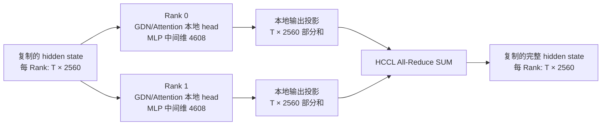

# 作业 2：Qwen3.5 双 Chip 张量并行与通信分析

## 1. 范围、分工与证据

本作业在一张 Ascend 910C 的两个 Chip 上，分别以 TP=2 部署
Qwen3.5-0.8B、4B、9B、27B。成员 A 负责基础 HCCL/启动及 0.8B、4B 适配，
成员 B 负责 9B、27B 的启动与正确性；成员 C 负责典型层切分图、通信路径、
TP=1/2 性能对照、通信实验与报告整合。分工草稿中的“模块级测试”不作为成员 C
新增交付要求。

本报告区分两组证据：

1. **已有团队证据**：[`qwen35_tp2_experiment_record.md`](qwen35_tp2_experiment_record.md)
   及 [`qwen35_4b_tp2_partition_communication.md`](qwen35_4b_tp2_partition_communication.md)。
   前者汇总四模型连续推理和正确性，后者依据配置和源码推导 4B 典型层切分；
   精简数据位于 `docs/evidence/`。原始 API 响应、服务器日志与失败记录在成员 B
   的实验服务器目录，不能把精简 Case 清单当作完整原始日志。
2. **成员 C 新测证据**：在团队共享 Ascend 服务器上，使用本分支源码快照 `22db9ec8`、
   物理 NPU 6/7、CANN 9.0.0、PyTorch/torch-npu 2.6.0、BF16 0.8B 权重
   测得。逐请求结果与 HBM 采样分别保存在
   [`08b_tp1_benchmark_c.json`](evidence/08b_tp1_benchmark_c.json) 和
   [`08b_tp2_benchmark_c.json`](evidence/08b_tp2_benchmark_c.json)。
   公开证据中的用户主目录统一写为 `$HOME`；数值与请求记录未改动。
   成员 B 的 9B/27B 环境为 PyTorch/torch-npu 2.9.0；两组数据不混作同环境性能对照。

## 2. 四模型 TP=2 连续推理及正确性

以下为成员 B 已整理的团队结果，详细请求输入、参考实现、数值分歧与证据边界见
[`qwen35_tp2_experiment_record.md`](qwen35_tp2_experiment_record.md)。

| 模型 | TP=2 连续请求 | TP=1 连续请求 | 完整输出 Token ID 一致性 |
|---|---:|---:|---:|
| 0.8B | 15/15 | 15/15 | TP1 vs TP2：11/15 |
| 4B | 15/15 | 15/15 | TP1 vs TP2：8/15；HF vs TP2：8/15 |
| 9B | 15/15 | 15/15 | TP1 vs TP2：10/15 |
| 27B | 15/15 | 当前单 Chip 配置未完成 | HF BF16 vs TP2：8/15 |

TP=1/2 使用相同模型权重、BF16、greedy 与输入 Token IDs；完整序列差异不等于
相应数量的语义错误。4B 的三方对照首 Token 15/15 一致。27B 的 HF 参考以
两 NPU **按层放置**权重，并非 TP=1，也不能用于计算 27B 的单 Chip 加速比。
既有分片日志显示 9B 的 GDN `out_proj` 从 `[4096,4096]` 切成每 Rank
`[4096,2048]`，27B 从 `[5120,6144]` 切成 `[5120,3072]`；两侧均完成
15 条请求。这比仅看到两个进程启动更有力，但不代替逐步 HCCL Trace。

## 3. 典型层切分与通信路径

选 Qwen3.5-4B：hidden size 2560，32 层中 24 层 GDN、8 层 Full Attention，
MLP intermediate size 9216。下图是
[`4B 切分说明`](qwen35_4b_tp2_partition_communication.md)的摘要，形状均为
**逻辑形状推导**；当前仓库尚未对每个中间张量逐项运行时 Hook 验证。

| 结构 | 两 Rank 的主要局部计算 | 合并点 | 推理状态 |
|---|---|---|---|
| GDN | Q/K 各 `[T,1024]`，V/Gate 各 `[T,2048]`；Conv 处理本地 4096 通道 | `out_proj` 每 Rank `[T,2560]` 部分和，经 `CommManager.post_attn_comm()` All-Reduce | Conv state 每 Rank逻辑 `[4096,3]`；recurrent state `[16,128,128]` |
| Full Attention | Q `[T,8,256]`，K/V 各 `[T,2,256]`；本地 KV head 计算 | `o_proj` 后同样经 `post_attn_comm()` All-Reduce | K/V cache 每 Rank 各 `[S,2,256]` |
| Dense MLP | Gate/Up 输出各 `[T,4608]`，本地激活后 Down 投影 | `post_mlp_comm()` → `post_dense_comm()` All-Reduce | 无同类递归状态 |

每个归约调用参与计算的 BF16 逻辑输入张量为 `T×2560×2 = 5120T` 字节，
这是每 Rank 的**输入 payload**，并非实际 HCCL 链路字节数。标准非 Token-Sharded
路径中，Conv state、recurrent state 与 KV cache 按本地通道/head 保留；通常
不逐步交换完整状态。Embedding/输出处理也可能有通信，不能把上表解释为全模型
只有三个 All-Reduce。

## 4. 0.8B TP=1/2 性能对照（成员 C 新测）

服务采用相同权重、BF16、`mha`、greedy、关闭 Thinking 和前缀缓存，
`max_model_len=4096`、`max_num_seqs=8`、`gpu_memory_utilization=0.30`。
输入经 chat template 后的实际长度精确为 32/1024 Token。输出上限 32，
`ignore_eos=true`；每格预热 1 次、正式测量 3 波。并发 1 时共 3 请求，
并发 4 时共 12 请求；全部成功。`benchmark_tp.py` 采用客户端流式计时，
系统吞吐为所有成功生成 Token 数除以三波总墙钟时间。TPOT 用首末内容块
时间差与服务端生成 Token 数估算，具体口径见
[`README-hw2.md`](../local_tests/qwen35/README-hw2.md)。

| 输入 Token | 并发 | TP1 吞吐 tok/s | TP2 吞吐 tok/s | TP2/TP1 | TP1 TTFT P50 s | TP2 TTFT P50 s | TP1 TPOT P50 ms | TP2 TPOT P50 ms |
|---:|---:|---:|---:|---:|---:|---:|---:|---:|
| 32 | 1 | 23.12 | 20.63 | 0.89× | 0.138 | 0.134 | 41.97 | 45.40 |
| 32 | 4 | 45.98 | 75.09 | 1.63× | 0.320 | 0.225 | 39.33 | 47.59 |
| 1024 | 1 | 13.67 | 15.22 | 1.11× | 1.178 | 0.662 | 36.72 | 45.09 |
| 1024 | 4 | 18.44 | 25.17 | 1.37× | 4.498 | 2.308 | 38.82 | 48.50 |

TP=2 在短输入单请求时没有吞吐收益；长输入 Prefill 的 TTFT 收益更明显。
并发 4 提高系统吞吐，但长输入下 TP=2 的 TTFT P95 仍达到 6.14 s，
说明排队或批处理尾部开销不能由吞吐数字掩盖。TP=2 的 TPOT 高于 TP=1，
与 Decode 小批量通信及额外同步开销相容；仅凭此表不能把差值完全归因于 HCCL。

| 配置 | 物理 NPU 6 总 HBM 峰值 MB | 物理 NPU 7 总 HBM 峰值 MB |
|---|---:|---:|
| TP1，32 输入，并发 1/4 | 26473 / 26478 | — |
| TP1，1024 输入，并发 1/4 | 26569 / 27098 | — |
| TP2，32 输入，并发 1/4 | 26132 / 26135 | 25532 / 25534 |
| TP2，1024 输入，并发 1/4 | 26185 / 26370 | 25585 / 25769 |

以上是共享设备的 `npu-smi` **总占用**，包括其他进程，且 0.5 秒采样可能漏掉
瞬时峰值；不能直接解释为模型独占 HBM，也不能把两颗设备的总量与单卡模型
显存作精确节省率比较。成员 B 的 9B/27B TP=2 单次运行快照分别为
`41932/41333 MB` 与 `48973/48377 MB`（物理 NPU 6/7），也同属设备总量，
不是独占峰值。

## 5. 通信相关实验与时间线

**假设与变量：**固定 0.8B 权重、TP=2、1024 输入 Token、32 输出 Token、
服务参数和物理 NPU 6/7，只改变同时发出的请求数为 1、4、8。每格预热一波，
正式测量三波；所有 39 个正式请求成功。按批处理机制，请求并发增加会使每次
集合通信所处理的 Token 数增多，但 All-Reduce 仍需跨 Chip 同步；预期系统
吞吐提高，单请求等待也可能增加。原始记录见
[`08b_tp2_concurrency_c.json`](evidence/08b_tp2_concurrency_c.json)。

| 并发 | 吞吐 tok/s | TTFT P50 s | TTFT P95 s | TPOT P50 ms | 物理 NPU 6/7 总 HBM 峰值 MB |
|---:|---:|---:|---:|---:|---:|
| 1 | 14.99 | 0.657 | 0.663 | 46.65 | 26180 / 25584 |
| 4 | 33.78 | 2.311 | 2.318 | 47.45 | 26346 / 25748 |
| 8 | 42.66 | 4.524 | 4.526 | 47.83 | 26728 / 26131 |

**结论：**并发 8 相比并发 1 的系统吞吐为 2.85 倍，TTFT P50 也增至
6.88 倍；TPOT 仅从 46.65 增至 47.83 ms。较大的 batch 能摊薄固定调度
与通信启动开销，并提高计算利用率，但会增加等待和单请求首 Token 延迟。
这些同时变化的因素不能仅凭吞吐曲线分离出 HCCL 的独立收益，也不能声称
“通信占比下降”已经实测。两颗 NPU 的 HBM 仍是共享设备总量。

**Profiler 时间线：**另用 CANN 9.0.0 `msprof --hccl=on --task-time=l1
--runtime-api=on` 采集 TP=2；详见
[`Rank 1 HCCL 统计原表`](evidence/08b_tp2_msprof_rank1_communication_c.csv) 与
[`时间窗摘要`](evidence/08b_tp2_msprof_summary_c.json)。Rank 1 / 物理 NPU 7
导出 4526 个 `hcom_allReduce_`、92 个 Broadcast、92 个 AllGather；前者在
**该 Rank 的 HCCL 累计 task duration** 中占 96.077%。这与典型层局部输出
经 All-Reduce 合并的源码路径相符；Broadcast/AllGather 也说明全服务通信
不止层内归约。统计涵盖整个 profiler 窗口，含启动和预热，不能对应单个请求。

在 Rank 1 的一个 10 秒时间窗，按 `op_summary` 的任务类型区分：AI Core/
Vector/Mix 计算任务的时间区间并集约 0.116 s，`hcom_` 通信任务并集约
9.724 s，AI CPU 等其他任务并集约 0.169 s。任务的 `Task Wait Time` 累计约
1.487 s，属于逐任务排队字段，**不是**主机调度等待或端到端等待；该采集无法
可靠拆出服务端排队时间。各区间可以重叠，不能相加。Profiler 显著拖慢请求，
而 Rank 0 未导出设备数据，因此这些数字仅证明采集窗口内的通信类型及设备
时间分布，**不能作为无 profiler 性能基线或双 Rank 通信占比**。无 profiler
的 TTFT 与吞吐取自上表及第 4 节。

## 6. 尚需补齐的证据边界

1. 27B TP=2 已有连续推理和容量快照，但当前 GitHub 交付没有可复核的
   吞吐/TTFT/TPOT 原始性能记录；不能在本报告中编造数值。成员 C 当前账号
   仅有 0.8B 权重，因而不能从这台服务器重新测 27B。
2. 4B 切分表是源码和配置推导；如需把每个中间张量写成“实测”，应增加运行时
   Hook 或 profiler 形状记录。
3. 0.8B 性能矩阵每格三波，适合展示趋势；若作为稳定性能结论，建议在资源
   独占或一致的共享负载下增加重复次数并报告波动。
